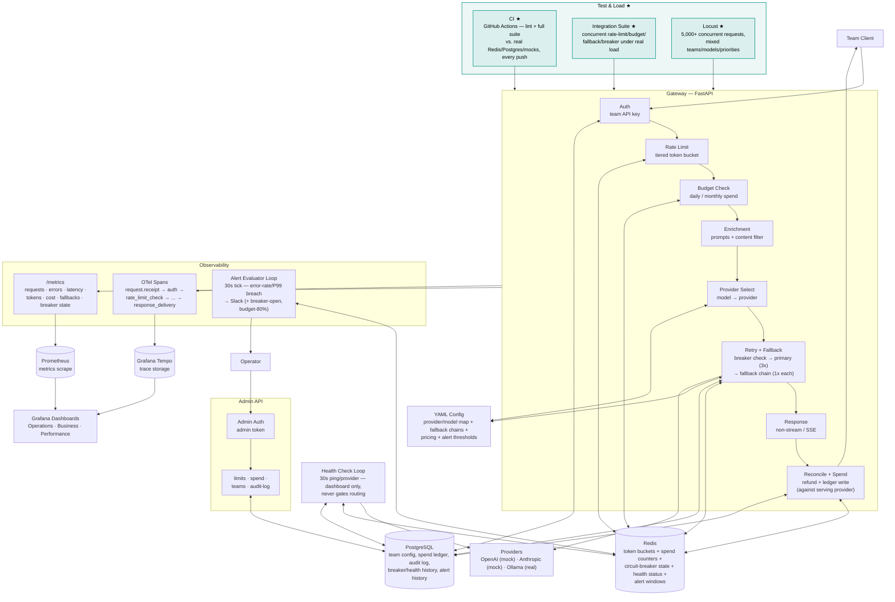

# Plexon

A production-style API gateway that sits in front of an organization's LLM calls. It authenticates teams, enforces per-team rate limits and budgets, transparently routes around provider outages, and gives unified observability across every LLM interaction — regardless of which underlying provider (OpenAI, Anthropic, Ollama) actually served the request.

Callers talk to Plexon exactly like they'd talk to OpenAI's Chat Completions API. Plexon decides which provider actually serves the request, retries and falls back on failure, and meters every call for rate limits, budget, and observability — without the caller ever knowing which provider was behind it.

> Portfolio/demo project, not a production system for a real organization — see [Non-Goals](#non-goals) below.

## Status

Phases 0–4 (`proxy-layer` through `test-load`) are merged into `main` — unified proxy, rate limiting/budgets, resilience/fallback, observability, and a CI-backed integration + load-test suite. Phases 5 (`benchmarks`) and 6 (`benchmark-scale`) are complete but not yet merged — they're the performance-benchmark suite and its concurrency-scale hardening, currently sitting on `feat-benchmarks`/`feat-benchmark-scale`. See [Build Plan](#build-plan) for the phase-by-phase status, [Demo](#demo) for a real transcript of the resilience path, and [Performance Benchmarks](#performance-benchmarks) for numbers from an actual run.

## Why This Project

Every company with more than one team using LLMs ends up building something like this. It's infrastructure engineering applied to AI: rate limiting, multi-provider failover, and observability — not model-building.

## Core Features

- **Unified proxy layer** — normalizes every request to an OpenAI-compatible schema and translates to/from each provider's native format, so callers never know which provider served them. Supports both streaming and non-streaming responses, and per-team request enrichment (system prompts, compliance disclaimers, rule-based content filters).
- **Rate limiting & budget enforcement** — per-team token-bucket rate limits (requests/min, tokens/min) enforced atomically in Redis, with tiered priority ceilings for `realtime` vs `batch` traffic. Per-team dollar budgets with an 80% warning and a hard block at 100%. Live admin API for adjusting limits without a restart.
- **Fallback & resilience** — background health checks per provider-model combination, fallback chains defined per model tier, exponential-backoff retry (up to 3 attempts) for retryable errors only, and a circuit breaker (closed → open → half-open) per provider with every transition logged.
- **Observability** — OpenTelemetry traces (→ Grafana Tempo) across every request stage, Prometheus metrics (RPS, error rate, latency percentiles, token throughput, cost, fallback rate, circuit-breaker transitions), three provisioned Grafana dashboards (Operations, Business, Performance), and Slack alerting with actionable context.
- **Testing & load** — integration tests against mocked providers with stateless per-request fault injection (no real API keys or network calls required), plus a Locust load test targeting 5,000+ concurrent requests at <10ms gateway overhead.

## Architecture

This diagram reflects what's actually built as of the current phase (see [Build Plan](#build-plan)) — it grows one phase at a time rather than showing the end-state up front.


★ = added this phase (`test-load`)

`auth` reads Postgres for team keys/config; `rate limit` and `budget check` run against Redis before the request is allowed to proceed (429 / 402 respectively), gating `enrichment` and `provider select` exactly like before. `provider select` resolves the requested model to a primary provider; `retry + fallback` checks that provider's circuit breaker, retries the primary up to 3x with backoff on transient errors, and on exhaustion walks the model's fallback chain, skipping any provider whose breaker is open. `reconcile + spend` records cost against whichever provider actually served the response; every request opens a root `request.receipt` span exported to Tempo and increments Prometheus counters/histograms/gauges scraped off `/metrics`, feeding three provisioned Grafana dashboards; a background alert evaluator loop pages Slack on an error-rate or P99-latency breach, and the circuit breaker/budget-check paths page Slack directly on breaker-open and 80%-budget-crossed. New this phase: a GitHub Actions CI workflow runs the full lint + test suite against real Redis/Postgres/mock-provider containers on every push; an integration test suite proves rate-limiting, budget enforcement, fallback activation, and circuit-breaker open/close hold up under real concurrent load (not just single-request unit tests); and a Locust scenario drives 5,000+ concurrent requests across mixed teams/models/priorities against the full Docker Compose stack, including a continuous simulated-outage task that keeps exercising the fallback/breaker path throughout the run. Full end-state request-flow spec in [`docs/TRD.md`](docs/TRD.md) §3.

**State is split three ways, by change frequency and durability:**

| Store | Holds | Why |
|---|---|---|
| **Redis** (hot-path) | rate-limit token buckets, circuit-breaker state, provider health status, running spend counter, per-provider alert-evaluation windows | fast-path enforcement only, never the system of record — rebuildable from Postgres |
| **PostgreSQL** (durable) | team configs, per-request spend ledger, admin audit log, circuit-breaker/health history, alert history | source of truth; per-team settings edited live via the admin API, no restart |
| **YAML** (static, hot-reloaded) | provider endpoints, fallback chains, circuit-breaker thresholds, health-check intervals, per-model pricing, alert thresholds | global/rarely-changed settings only, never per-team |

The gateway process itself is stateless — nothing important lives only in memory — so the design supports horizontal scaling without rework, even though the demo runs a single instance.

Full detail: [`docs/ARCHITECTURE.md`](docs/ARCHITECTURE.md) (condensed) and [`docs/TRD.md`](docs/TRD.md) (data model, API spec, provider-adapter interface, deployment services).

### Directory Structure

```
plexon/
├── gateway/
│   ├── main.py
│   ├── auth/            # team key + admin token lookup
│   ├── ratelimit/        # Redis token bucket, tier ceilings
│   ├── providers/        # adapters: openai, anthropic, ollama
│   ├── resilience/       # circuit breaker, retry/backoff, health checks
│   ├── enrichment/       # system prompts, content filter
│   ├── admin/            # admin API routes
│   ├── observability/    # OTel spans, Prometheus metrics
│   └── config/           # YAML loader + hot reload
├── mocks/                 # mock OpenAI/Anthropic servers with fault injection
├── tests/
│   ├── integration/
│   └── load/               # Locust scenarios
├── deploy/
│   ├── docker-compose.yml
│   ├── grafana/            # provisioned dashboards
│   └── prometheus/
├── scripts/
│   └── setup_demo_teams.py
└── docs/
```

## Tech Stack

| Layer | Choice |
|---|---|
| Language / framework | Python 3.11+, FastAPI |
| Hot-path store | Redis |
| Durable store | PostgreSQL |
| Static config | YAML, file-watched hot reload |
| Tracing | OpenTelemetry → Grafana Tempo |
| Metrics | Prometheus |
| Dashboards | Grafana |
| Alerting | Slack incoming webhook (env-gated) |
| Providers | OpenAI (mocked), Anthropic (mocked), Ollama (real) |
| Load testing | Locust |
| Retry / backoff | `tenacity` |
| CI | GitHub Actions, real Redis/Postgres service containers |
| Packaging | `uv` |
| Containerization | Docker + Docker Compose |

## API Surface

There is no custom UI. The product surfaces are the gateway API, the admin API, and Grafana's provisioned dashboards.

| Method | Path | Auth | Notes |
|---|---|---|---|
| POST | `/v1/chat/completions` | team API key | OpenAI-compatible; `stream: true/false`; optional `X-Priority: realtime\|batch` header |
| GET | `/v1/models` | team API key | models allowed for the caller's team |
| GET | `/healthz` | none | liveness probe |
| GET | `/admin/teams/{team_id}/status` | admin token | current rate-limit/budget status |
| PATCH | `/admin/teams/{team_id}/limits` | admin token | adjust rate limits/budget live |
| GET | `/admin/teams/{team_id}/spend` | admin token | spend dashboard data |
| POST | `/admin/teams` | admin token | create a team |
| GET | `/admin/audit-log` | admin token | query audit history |
| POST | `/admin/config/reload` | admin token | manual YAML reload trigger |

Team API keys and admin tokens are two independent opaque-token systems — never a single token encoding both.

## Getting Started

```bash
uvicorn gateway.main:app --reload               # dev server
pytest                                           # tests (mocked providers — no API keys or network calls needed)
ruff check .                                     # lint
docker compose -f deploy/docker-compose.yml up   # full stack: gateway, Redis, Postgres, Prometheus, Grafana, Tempo, mocks
python3 scripts/setup_demo_teams.py              # seed demo teams with varied rate limits/priorities
```

## Build Plan

Implementation is split into 5 [Harness](.claude/commands/harness.md) phases covering the original build plan, plus `benchmarks` and `benchmark-scale` phases added afterward, each on its own `feat-{phase}` branch, run via `scripts/execute.py`:

| # | Phase | Covers | Status |
|---|---|---|---|
| 0 | `proxy-layer` | Project setup, provider abstraction, auth/routing, streaming passthrough, enrichment | ✅ merged |
| 1 | `ratelimit-budget` | Token buckets, budget caps, tiered limits, admin API | ✅ merged |
| 2 | `resilience` | Health checks, fallback routing, retry/backoff, circuit breakers | ✅ merged |
| 3 | `observability` | OTel spans, Prometheus metrics, Grafana dashboards, alerting | ✅ merged |
| 4 | `test-load` | Integration test suite, Locust load test, full Docker Compose stack | ✅ merged |
| 5 | `benchmarks` | Performance benchmark suite: throughput, gateway overhead, failover reliability/recovery, rate-limit/budget accuracy under concurrency | ✅ complete, unmerged (`feat-benchmarks`) |
| 6 | `benchmark-scale` | Concurrency-sweep scale testing for throughput/overhead/failover/rate-limit benchmarks, plus a budget-overshoot root-cause investigation (ADR-028) | ✅ complete, unmerged (`feat-benchmark-scale`) |

A final polish phase (demo recording + narrative) is done manually, outside Harness — see [Demo](#demo) below.

## Demo

A real, runnable transcript showing the resilience path end to end: a request routed to the primary provider, the primary failing, the circuit breaker opening, the fallback provider serving traffic, and the breaker recovering after cooldown — with latency evidence (retry cost visibly dropping once the breaker opens) pulled straight from the gateway's own Prometheus metrics, not narrated.

```bash
docker compose -f deploy/docker-compose.yml up -d --build
python3 scripts/setup_demo_teams.py
uv run python3 scripts/demo_circuit_breaker_failover.py
```

Full transcript and walkthrough: [`docs/demos/circuit-breaker-failover.md`](docs/demos/circuit-breaker-failover.md).

## Performance Benchmarks

A manually-invoked suite (`benchmarks/`) that measures gateway performance against a live Docker Compose stack, giving a fast local regression signal separate from CI's correctness tests.

**Prerequisites** — same as `tests/load/locustfile.py`'s: the full stack running and demo teams seeded:

```bash
docker compose -f deploy/docker-compose.yml up -d --build
python3 scripts/setup_demo_teams.py
```

**What's measured:**
- Sustained throughput as a concurrency sweep (5 → 20 → 50 → 100 → 200 workers), reporting the maximum concurrency/RPS sustained with zero errors against `THROUGHPUT_MIN_RPS`
- Gateway-only overhead latency (P50/P95/P99) across the same concurrency sweep, read off the `gateway_overhead_seconds` Prometheus histogram — concurrency=5 is the calibrated pass/fail gate against `OVERHEAD_P95_MS`
- Failover reliability and switch latency when a provider starts failing, run as multiple independent outage trials (default 5 × 20 requests) with the breaker reset to closed between each, reporting the aggregate request count behind the pooled reliability percentage
- Circuit-breaker recovery latency after cooldown
- Rate-limit admission accuracy (pooled across `_RPM_TRIALS` independent 200-concurrent trials against fresh teams, ~10,000 requests total by default) and budget-overshoot bounds under concurrent load

**How to run:**

```bash
uv run pytest benchmarks/ -m benchmark -v
# or
uv run python3 benchmarks/run_all.py
```

Results land in `benchmarks/results/*.json` and `*.csv` (gitignored, regenerated on each run).

**Results from an actual run** (2026-10-16, single Apple M4 / 24GB laptop, full stack in Docker Compose, mocked OpenAI/Anthropic providers per ADR-006 — no real API keys or network calls):

| Concurrency | Achieved RPS | End-to-end P95 | Gateway-only overhead P95 |
|---|---|---|---|
| 5 | 356 | 20ms | **5ms** (the calibrated pass/fail gate) |
| 20 | 420 | 70ms | 25ms |
| 50 | 300 | 229ms | 59ms |
| 100 | 275 | 578ms | 91ms |
| 200 | 230 | 1,141ms | 75ms |

- **Failover reliability:** 100% (100/100 requests across 5 independent outage trials) with a 381ms median / 495ms P95 switch latency from primary failure to a successful fallback response.
- **Circuit-breaker recovery:** ~30s after a sustained outage, matching the configured 30s cooldown — one healthy probe is enough to close the breaker again (see the [Demo](#demo) above for a live transcript).
- **Rate-limit admission accuracy:** 0 incorrect admissions across 10,000 pooled requests (50 trials × 200 concurrent), 602ms P95 rejection latency.
- **Budget overshoot under concurrency:** ~3% over the cap at 40-way concurrency — a known, bounded check-then-act race documented in ADR-028, not a benchmark-code defect.

Only concurrency=5 is a hard pass/fail gate (`OVERHEAD_P95_MS`); higher concurrency levels are reported for visibility, not asserted — gateway-only overhead rising with concurrency mostly reflects contention in this benchmark's own local client loop and the 10-connection Postgres pool, not necessarily the gateway itself. Per [Non-Goals](#non-goals), these numbers are a regression signal, not a performance claim — re-run `uv run pytest benchmarks/ -m benchmark -v` against your own hardware for current numbers.

This suite is a fast, single-process, locally-run regression signal — it doesn't replace `tests/load/locustfile.py`, which remains the tool covering TRD §10's large-scale "5,000+ concurrent requests" requirement. Per [Non-Goals](#non-goals), raw throughput isn't this project's headline story; these benchmarks exist to catch regressions, not to make a performance claim.

## Non-Goals

- Not a production system for a real organization — no key rotation, no multi-region HA, no real user-account/RBAC system.
- Not a content-moderation project — content filtering is rule-based (keyword/regex), not an ML classifier.
- Not optimizing for raw throughput as the headline story.

## Documentation

| Doc | Contents |
|---|---|
| [`docs/PRD.md`](docs/PRD.md) | Product requirements: goals, users, features, success metrics, assumptions, open risks |
| [`docs/ARCHITECTURE.md`](docs/ARCHITECTURE.md) | Condensed architecture: directory structure, patterns, data flow, state management |
| [`docs/TRD.md`](docs/TRD.md) | Technical reference: system components, request flow, data model (SQL/Redis schemas), API spec, provider-adapter interface, observability detail, deployment |
| [`docs/ADR.md`](docs/ADR.md) | Architecture decision records — the rationale behind every major technical choice |
